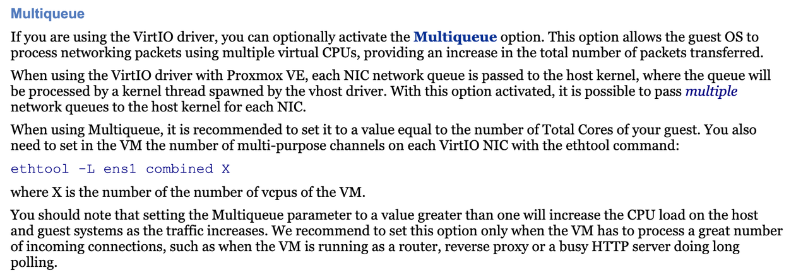
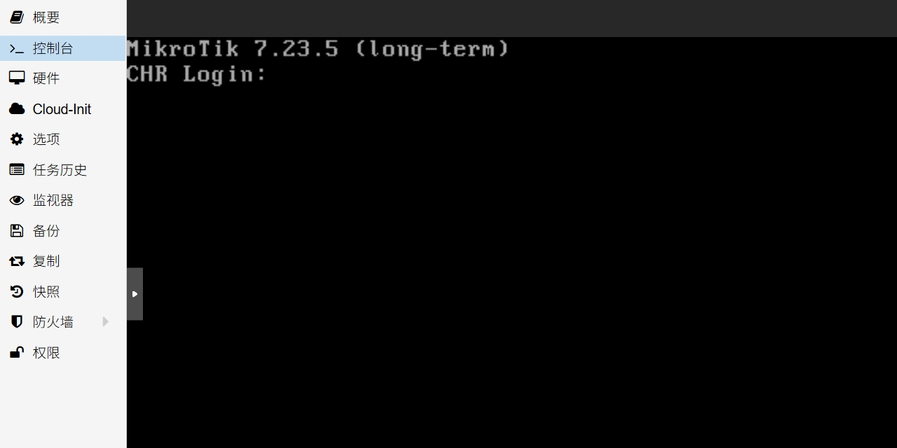
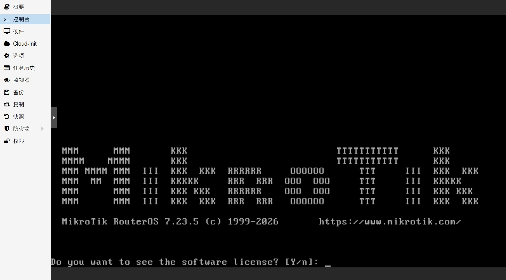

## 0.前期准备

一台工作正常的 PVE 服务器， PVE 安装与配置方法参考我的系列文章 [Proxmox VE 折腾手记](https://gitee.com/callmer/pve_toss_notes) 。  

一台已经联网的 `前置路由器` 或 `光猫` ，用于 RouterOS 系统激活。  

访问 RouterOS 的官网 [Mikrotik](https://mikrotik.com/download) 下载最新的 Winbox 软件、RouterOS 镜像以及镜像文件对应的校验信息。  

- Winbox: 根据所使用的操作系统类型，下载合适的 Winbox 客户端软件。  

- RouterOS 镜像: PVE 中运行 RouterOS 需要 `.img` 格式的镜像，因此选择 `RAW disk` 。  

## 1.创建 RouterOS 虚拟机

### 1.1.常规

登录到 PVE 后台后，进入新建虚拟机流程，并打开底部 `高级` 选项。  

`节点` 选择当前设备，`VM ID` 和 `名称` 可自定义。  

`启动/关机顺序` 和 `启动延时` 可按需调整。  


### 1.2.操作系统

操作系统 `类别` 选择 `Linux` 、内核 `版本` 选择 `7.x - 2.6 Kernel` 即可，且无需使用引导介质。  


### 1.3.系统

`显卡` 选择 `默认` ，`机型` 选择 `q35` ，对 `PCIE` 直通设备有更好的支持。  

新版的 RouterOS 对 `Qemu Agent` 支持良好，因此建议勾选 `Qemu 代理` 选项。    

如果后续使用过程中 RouterOS **不稳定** ，请保持 `机型` 选择 `默认 (i440fx)` 。


### 1.4.磁盘

后续将导入 RouterOS 镜像文件并生成磁盘，因此移除所有自动添加的磁盘。  


### 1.5.CPU

请根据物理设备 CPU 资源使用情况来分配 RouterOS CPU 资源。  

CPU `类型` 选择 `host` ，`核心` 根据物理 CPU 核心数进行酌情设置。  

如果设备有多路 CPU 推荐启用 **NUMA** 。  

如果设备 CPU **超分（Over-Commit）** 比较严重，可适当将 `CPU 权重` 参数翻倍，让 RouterOS 获得更多的 CPU 时间。  
 


### 1.6.内存

内存一般 `2048MiB` 足够使用，MikroTik 官方给出的 CHR 最低要求是 `256MiB` ，但建议至少分配 `1024MiB` 。  


### 1.7.网络

需要注意，当前页面只能设置单个网络设备，而网络设备的添加顺序将和 RouterOS 内部显示的网卡顺序一致。  

因此，先仅添加 `WAN` 对应的网口（ 此处为 `vmbr0` ），`型号` 选择 `VirtIO (半虚拟化)` ，并取消勾选 `防火墙` 选项。  

对于使用硬件直通的小伙伴，可根据实际情况来修改此处网络设备选项。  

推荐在 **Multiqueue** 处根据前面设置的 CPU 数量进行网卡多队列设置，设置比例为 1:1 。  

即有 n 个 CPU 核心，此处多队列也设置为 n 。  


根据官方文档中对 `Multiqueue` 的描述：  



因此，对于使用 `VirtIO` 网卡的虚拟机，特别是作为路由器使用且需处理大量带宽时，可以在一定程度上提高其网络吞吐性能。  

但 RouterOS v6 版本对 `Multiqueue` 可能未良好支持，因此建议 RouterOS v7 及以上版本开启该选项。  

### 1.8.确认

接下来查看设置总览，确认无误后，即可点击 `完成` 。  


## 2.调整网络设备

此时，查看虚拟机详情页，可以看到刚创建好的虚拟机。  


去掉 CD/DVD 驱动器后，开始添加网络设备。  


重复添加网络设备，去掉防火墙，并增加网卡多队列参数后，示例如下：  


## 3.添加 VirtIO RNG

为确保系统拥有充足的可用熵，需为 RouterOS 虚拟机添加 `VirtIO RNG` 熵源。  

点击顶部 `新增` 菜单，选择 `VirtIO RNG` 。  


`熵源` 选择 `/dev/urandom` ，其余参数保持默认即可。  


## 4.创建 RouterOS 系统盘

### 4.1.获取镜像文件

使用终端工具登录到 PVE 服务器，在 `/tmp` 目录中创建一个目录用于下载 RouterOS 镜像文件。  

```bash
## 创建并进入目录
$ mkdir -p /tmp/RouterOS && cd /tmp/RouterOS

## 下载 RouterOS 镜像校验文件
$ curl -LR -O https://download.mikrotik.com/routeros/7.24.6/chr-7.24.6.img.zip.sha256

## 下载 RouterOS 镜像文件
$ curl -LR -O https://download.mikrotik.com/routeros/7.24.6/chr-7.24.6.img.zip
```

镜像文件下载完成后，使用官方提供的校验文件验证镜像完整性。  

```bash
## 检查文件是否存在
$ ls -lah

## 执行镜像文件校验
$ sha256sum --check chr-7.24.6.img.zip.sha256

#### 镜像校验成功示例输出
chr-7.24.6.img.zip: OK
```

由于镜像文件为 `zip` 压缩格式，无法直接使用，因此需要对其解压缩，执行以下命令，解压出 `.img` 格式镜像。  

```bash
## 将镜像文件解压缩
$ python3 -m zipfile -e chr-7.24.6.img.zip "$(pwd)"
```

### 4.2.导入镜像文件

在创建 RouterOS 虚拟机时，曾指定了 `VM ID`，使用该 `VM ID` 将 RouterOS 镜像导入 PVE 系统，演示中为 **`101`** 。  


```bash
## 将 img 镜像导入虚拟机中
$ qm importdisk 101 chr-7.24.6.img local-lvm

#### img 镜像导入示例输出
unused0: successfully imported disk 'local-lvm:vm-101-disk-0'
```

### 4.3.调整虚拟机磁盘设置

磁盘导入成功后，虚拟机硬件列表中将显示一块未使用的磁盘设备，可鼠标 **双击** 该设备进行配置调整。  


当宿主机使用 SSD 作为物理存储设备，并且虚拟磁盘采用 Thin Provisioning （精简置备）模式时，可考虑开启以下选项：  

- `丢弃` （ `Discard` ） 选项，有助于存储空间回收。  

- `SSD 仿真` （ `SSD Emulation` ） 选项，让虚拟机将虚拟磁盘视为 SSD 存储设备。  

在弹出的对话框中，确认 `IO thread` 选项为 **勾选** 状态，并点击 `新增` 。  


导入的镜像仅具备 `128MiB` 磁盘空间，为方便后续使用，可通过 `qm` 命令直接将该磁盘调整至目标容量。  

```bash
## 将镜像容量设置为 2G
$ qm disk resize 101 scsi0 2G

#### 镜像扩容示例输出
  Size of logical volume pve/vm-101-disk-0 changed from 128.00 MiB (32 extents) to 2.00 GiB (512 extents).
  Logical volume pve/vm-101-disk-0 successfully resized.
```

或 **单击** 选中该磁盘，然后使用 `磁盘操作` 菜单中的 `调整大小` 选项对磁盘镜像进行扩容。  


本文作为演示，在弹出的对话框中，给该磁盘仅增加 `1.875GiB` 磁盘空间。  


镜像磁盘扩容后，在虚拟机 **初次启动** 时，RouterOS 会根据磁盘空间自动扩容内部文件系统。  


## 5.创建 RouterOS 日志盘

RouterOS 的日志一般记录在内存中，当系统重启后，历史日志将会丢失。  

而使用附加硬盘来记录 RouterOS 的日志，可在系统意外重启时看到历史日志，方便追溯问题。  

点击顶部 `新增` ，选择 `硬盘` ：  


`总线/设备` 选择 `SCSI` ，设备编号 PVE 会自动设置，演示中为 `1` 。  

`磁盘大小` 根据 PVE 服务器资源剩余情况酌情设置，演示为 `1GiB` 。  


日志盘添加完成后，如图所示。  


## 6.调整虚拟机配置参数

初创的 RouterOS 的配置参数如下，需要进一步调整的参数包括：  
- 开机自启动（建议在 RouterOS 完全设置好之后再修改）  
- 启动/关机顺序（建议在 RouterOS 完全设置好之后再修改）  
- 引导顺序  
- 使用平板指针  


### 6.1.设置开机自启动

开机自启动设置为 “是” ，启动顺序推荐如下：  
- `启动/关机顺序` 为 `1` ，表示该虚拟机第一个启动，最后一个关机  
- `启动延时` 为 `15` ，表示该虚拟机启动后，延迟 `15` 秒再启动下一个虚拟机  


### 6.2.修改引导顺序

在 `net0` 设备处，**取消勾选** “已启用” 复选框。  

在 `scsi0` 设备处勾选 “已启用” 复选框，并通过排序功能将其拖拽至首位，点击 `确定` 即可。  


### 6.3.修改平板指针设置

关闭 `使用平板指针` 选项，可以一定程度上降低虚拟机的 CPU 使用率。  


修改完成后，总体情况如下，等待 RouterOS 完全配置好，运行无异常之后，即可开启该虚拟机的 `开机自启动` 选项。  


### 6.4.设置虚拟机备注信息

进入左侧虚拟机 `概要` 页面，修改虚拟机的备注信息。  

```bash
### 服务器信息

- 系统： RouterOS

- 用途： 主路由系统

- 自启： 是

- 用户： admin ( 只读 )

- 用户： fox ( 管理 )

- IPv4： 172.16.1.1/24

- IPv6： DHCPv6 Client

```


## 7.虚拟机开机

接下来检验 RouterOS 虚拟机是否能正常启动，切换至虚拟机的 `控制台` 选项卡即可开机。  

当前 RouterOS 尚未进行任何配置，不会对现有网络环境造成影响，但需留意后续配置细节：若 RouterOS 设置了内部网络接口桥接，而 PVE 环境中已有其他路由系统（例如 OPNsense 防火墙）在相同网络接口上启用桥接功能，可能会引发网络环路，导致网络无法正常访问。  

待虚拟机启动后，若控制台显示如图所示内容，即表明 RouterOS 已安装成功。  



RouterOS 的默认账户为 `admin` ，无需密码即可登录。  



至此，RouterOS 虚拟机安装步骤完成。  

